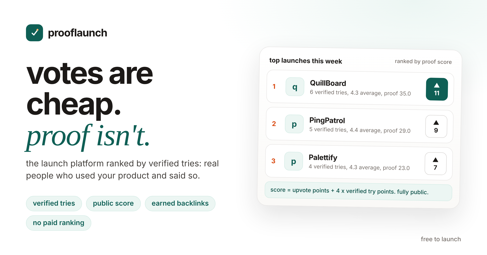
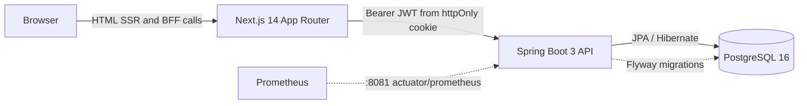

<div align="center">



# ProofLaunch

**Votes are cheap. Proof isn't.**
A product-launch platform that ranks products by *verified usage*, not hype.

</div>

---

## Table of contents
1. [Why ProofLaunch](#why-prooflaunch)
2. [How we're different](#how-were-different)
3. [Features](#features)
4. [The Proof Score](#the-proof-score)
5. [Architecture](#architecture)
6. [Tech stack and why](#tech-stack-and-why)
7. [Quick start (Docker)](#quick-start-docker)
8. [Local development](#local-development)
9. [Configuration](#configuration)
10. [API overview](#api-overview)
11. [Data model](#data-model)
12. [Security](#security)
13. [Observability](#observability)
14. [Testing](#testing)
15. [Project structure](#project-structure)
16. [Honest limitations and roadmap](#honest-limitations-and-roadmap)

---

## Why ProofLaunch

Launch boards (Product Hunt, Fazier, ProductsFarm, Peerlist and others) all rank on **upvotes**, and upvotes are the cheapest signal on the internet: easy to trade, easy to farm, and unrelated to whether anyone used the product. On top of that, paid/promoted shelves and paid dofollow links make the board feel pay-to-play.

ProofLaunch fixes the incentive: **a product climbs by getting real people to try it and say something honest.**

## How we're different

| | Typical launch boards | **ProofLaunch** |
|---|---|---|
| Main ranking signal | Raw upvotes | **Verified tries** (use it, wait, rate, write feedback) + trust-weighted upvotes |
| Can you see why a product ranks where it does? | No | **Yes**: every product shows its score breakdown |
| Paid placement | Promoted / premium shelves | **None. Ever.** |
| Backlink (SEO value) | Often a paid perk | **Earned** automatically (3+ verified tries, avg ≥ 3.5★) |
| New/throwaway accounts | Often count fully | Count **25%**, ramping to 100% over 14 days |
| Maker feedback | Comment threads | Structured: rating + written feedback + **funnel** (started → completed) |
| Self-voting | Policing needed | Blocked by the API |

## Features

- Marketing landing page, `/launches` leaderboard (today / week / month / all-time, category filters, pagination) and a **ctrl+k command palette** with live search
- **Pricing page** with a free plan and a pro plan (early access waitlist). Pro sells tools, never rank
- **Verified Try** flow with server-side timer (cannot be sped up from the browser)
- Trust-weighted upvotes (toggle on/off), one per user per product
- Public **Proof Score breakdown** and a [How ranking works](frontend/app/how-scoring-works/page.tsx) page
- **Earned dofollow** backlinks (nofollow by default)
- **Verified maker** badge when email domain matches the product site
- Maker **dashboard**: kpis, try funnel per product, edit and delete
- **Embeddable proof badge** (live svg) with copy-paste embed code
- Submit form with **live preview**, split-screen sign in and sign up, loading skeletons, empty and error states
- SEO: server-side rendering, per-page metadata, canonical URLs, JSON-LD (`SoftwareApplication` + `AggregateRating`), `sitemap.xml`, `robots.txt`, Open Graph image
- Accessibility: skip link, semantic landmarks, labelled controls, visible focus styles, reduced-motion support
- Auth with BCrypt + JWT, stored in an **httpOnly cookie** (never visible to JavaScript)
- Rate limiting on auth endpoints, URL safety rules, duplicate-product detection, per-day launch cap

## Design system

Light only, on purpose: a launch directory reads best on a calm, bright canvas. The whole interface follows one lowercase voice, a warm neutral palette with a single deep-green brand colour, an 8px spacing rhythm, Inter for text and Instrument Serif italics for accent words, inline svg icons (no emoji), visible focus rings, and 44px-class touch targets. No dark mode.

## The Proof Score

```
Proof Score  = upvote points + verified-try points
upvote pts   = Σ trust weight of each upvote
try pts      = 4 × Σ trust weight of each verified try rated ≥ 3★
trust weight = 0.25 + 0.75 × min(accountAgeDays, 14) / 14
```

A **verified try** = start → product opens → feedback unlocks only after **45 s** (server clock) → rating 1 to 5 + feedback of 10 to 1000 characters. One per user per product. Makers cannot vote or try their own product.

All of this lives in pure, unit-tested classes: [`domain/`](backend/src/main/java/com/prooflaunch/domain).

## Architecture



- **Browser never talks to the API directly.** Pages are rendered on the server; interactive actions go through the same-origin `/bff/*` proxy, which attaches the JWT from an httpOnly cookie. No tokens in `localStorage`, no CORS in production.
- **Backend** is layered by feature: `controller → service → repository → entity`, with DTO records at the edge and a global RFC 7807 error handler.
- **Counters are recomputed, not incremented.** Every vote/try takes a row lock on the product, then recomputes upvote/try aggregates from the source tables, so numbers can't drift or lose updates.

## Tech stack and why

| Layer | Choice | Reason |
|---|---|---|
| Frontend | **Next.js 14 (App Router) + TypeScript** | A launch board lives on SEO. Product pages must be server-rendered HTML with metadata, JSON-LD and a sitemap. Plain React SPA can't do that well. |
| Styling | Hand-written CSS with design tokens | Zero build config, tiny payload, one consistent light theme |
| Backend | **Spring Boot 3.3 / Java 21** | Mature, strongly typed, excellent security + validation + actuator ecosystem |
| Data access | **Spring Data JPA + Hibernate** | Required stack; entity graphs avoid N+1; JPQL for the leaderboard |
| Database | **PostgreSQL 16** | Votes need strict relational integrity (`UNIQUE(user, product)`), transactions, `CHECK` constraints and row-level locks. A document store would push all of that into app code. |
| Migrations | **Flyway** | Versioned, reviewable schema; Hibernate never alters tables (`ddl-auto: none`) |
| Auth | Spring Security + **JWT (jjwt)** + BCrypt(12) | Stateless API, horizontal scaling without sticky sessions |
| API docs | springdoc-openapi (Swagger UI in dev) | Self-documenting; disabled in Docker |
| Observability | Actuator + Micrometer/Prometheus + request-id logging | Minimal but production-useful |
| Build/Run | **Maven**, multi-stage **Docker**, docker-compose | Reproducible builds, small non-root runtime images |

## Quick start (Docker)

Requires Docker with Compose v2.

```bash
cp .env.example .env
# edit .env: set DB_PASSWORD and JWT_SECRET  (openssl rand -base64 48)
docker compose up --build
```

Open **http://localhost:3000**. With `SPRING_PROFILES_ACTIVE=demo` (default in `.env.example`) you get fictional sample products. Sign in as `maker@demo.prooflaunch.dev` / `DemoPass#2026`, or register a new account.

> Only the web container is published. The API (`8080`) and actuator (`8081`) stay on the internal Docker network.
> Remove `demo` from `SPRING_PROFILES_ACTIVE` for any real deployment.

## Local development

**Prerequisites:** JDK 21, Maven 3.9+, Node 20+ (22 recommended), PostgreSQL 16 (or `docker run`).

```bash
# 1) database
docker run -d --name pl-db -p 5432:5432 \
  -e POSTGRES_DB=prooflaunch -e POSTGRES_USER=prooflaunch -e POSTGRES_PASSWORD=prooflaunch postgres:16-alpine

# 2) backend  (http://localhost:8080, Swagger UI at /swagger-ui.html)
cd backend
SPRING_PROFILES_ACTIVE=demo mvn spring-boot:run

# 3) frontend (http://localhost:3000)
cd ../frontend
npm install
npm run dev
```

## Configuration

| Variable | Default | Purpose |
|---|---|---|
| `DB_URL` / `DB_USER` / `DB_PASSWORD` | local Postgres | Database connection |
| `JWT_SECRET` | dev-only value | **Required in production**, ≥ 32 chars |
| `JWT_EXPIRATION_MINUTES` | `120` | Token lifetime |
| `MIN_TRY_SECONDS` | `45` | Dwell time before feedback unlocks |
| `MAX_LAUNCHES_PER_DAY` | `3` | Per-maker launch cap per 24 h |
| `AUTH_RATE_LIMIT_PER_MINUTE` | `20` | Per-IP limit on `/api/auth/*` POSTs |
| `CORS_ALLOWED_ORIGINS` | `http://localhost:3000` | Only needed if a browser calls the API directly |
| `MANAGEMENT_PORT` | `8081` | Actuator port |
| `SWAGGER_ENABLED` | `true` | Disabled in Docker |
| `API_URL` (web) | `http://localhost:8080` | Where Next.js reaches the API |
| `SITE_URL` (web) | `http://localhost:3000` | Canonical URL, sitemap, OG |
| `COOKIE_SECURE` (web) | `false` | Set `true` behind HTTPS |

> `MIN_TRY_SECONDS` is also mirrored as a constant in `frontend/app/products/[slug]/page.tsx` for UI copy only; the server is the source of truth.

## API overview

Interactive docs: `/swagger-ui.html` (dev). Errors are `application/problem+json` with a stable `code`.

| Method | Path | Auth | Description |
|---|---|---|---|
| POST | `/api/auth/register`, `/api/auth/login` | none | Create account / sign in |
| GET | `/api/me` | ✔ | Current user |
| GET | `/api/products?period=&category=&q=&page=&size=` | optional | Leaderboard |
| GET | `/api/products/{slug}` | optional | Product detail + score breakdown |
| POST | `/api/products` | ✔ | Launch (rate-limited, duplicate-checked) |
| PUT / DELETE | `/api/products/{id}` | owner | Edit / delete |
| GET | `/api/me/products` | ✔ | Maker dashboard data |
| PUT / DELETE | `/api/products/{id}/upvote` | ✔ | Add / remove upvote (idempotent) |
| POST | `/api/products/{id}/try/start` | ✔ | Begin a verified try |
| POST | `/api/products/{id}/try/complete` | ✔ | Submit rating + feedback |
| GET | `/api/products/{id}/tries` | none | Verified feedback list |
| GET | `/api/products/{id}/viewer` | optional | What the viewer can do now |
| GET | `/api/categories`, `/api/sitemap` | none | Reference data / SEO |
| GET | `/api/products/{slug}/badge.svg` | none | Embeddable proof badge |
| POST | `/api/waitlist` | none | Join the pro early-access list (rate limited, idempotent) |

## Data model

`users` · `categories` · `waitlist_entries` · `products` (denormalised score columns) · `votes` (`UNIQUE(user_id, product_id)`, weight snapshot) · `product_tries` (`UNIQUE(user_id, product_id)`, status `STARTED|COMPLETED`, `CHECK` constraints enforce rating range and that completed rows have feedback). See [`V1__init.sql`](backend/src/main/resources/db/migration/V1__init.sql).

## Security

- Passwords: BCrypt cost 12; constant-time-ish login (dummy hash for unknown emails)
- JWT (HMAC) in an **httpOnly, SameSite=Lax** cookie, attached server-side by the BFF
- Stateless API, CSRF not applicable to bearer auth; BFF mutations rely on SameSite cookies
- Bean validation on every request body; RFC 7807 errors that never leak stack traces
- Only public **https** URLs may be listed (blocks `javascript:`, localhost, raw IPs, credentials in URL)
- Per-IP rate limit on auth; per-maker launch cap; self-vote and duplicate protection; DB constraints as the last line of defence
- Security headers (`nosniff`, `X-Frame-Options`, `Referrer-Policy`, `Permissions-Policy`)
- Non-root containers; secrets only via environment

## Observability

- **Health:** `/actuator/health/liveness` and `/readiness` on the management port (`8081`, not published)
- **Metrics:** `/actuator/prometheus` plus custom counters `prooflaunch_upvotes_total`, `prooflaunch_tries_started_total`, `prooflaunch_tries_completed_total`, `prooflaunch_products_created_total`
- **Logging:** every request gets an `X-Request-Id`, included in each log line (`%X{requestId}`) and returned to the client

## Testing

```bash
cd backend && mvn test        # unit tests for all ranking / anti-gaming rules
cd frontend && npm run typecheck && npm run lint
```

The business rules (trust weight, score formula, try timing, URL safety, slugs, maker verification, periods) are framework-free and covered in `DomainRulesTest`.

## Project structure

```
prooflaunch/
├── backend/                      Spring Boot API (Maven)
│   └── src/main/java/com/prooflaunch/
│       ├── domain/               pure rules: score, trust, timing, URL, slugs
│       ├── engagement/           votes + verified tries + score recompute
│       ├── product/              leaderboard, CRUD, mapper
│       ├── user/  category/      auth + reference data
│       ├── security/  config/    JWT, filters, rate limit, beans
│       ├── common/  observability/
│       └── demo/                 demo data (profile "demo")
├── frontend/                     Next.js 14 (App Router, TypeScript)
│   ├── app/                      landing, launches, pricing, product, dashboard, /bff + /badge routes
│   ├── components/  lib/
├── docker-compose.yml  .env.example
└── docs/launch-image.png
```

## Pricing model

| | free | pro (early access) |
|---|---|---|
| price | $0 forever | $12 per month, or $96 per year |
| launch, rank, score breakdown, earned dofollow, badge, dashboard | yes | yes |
| launches per day | 3 | 10 |
| analytics over time, csv export, launch scheduling, invite links, 3 seats | no | yes |
| ranking boost | none | none |

Other launch boards sell homepage slots and guaranteed dofollow links for one-time fees (commonly $12 to $99). That is pay-to-rank, which contradicts our core promise, so pro sells **tools** only. Pro is not billed yet: the pricing page collects waitlist emails through `POST /api/waitlist`.

## Honest limitations and roadmap

- A "try" proves *intent plus effort*, not that the user truly used the product on a third-party site. We raise the cost of cheating; we don't claim to eliminate it. Roadmap: optional maker SDK/webhook to confirm real sessions.
- Rate limiter is in-memory (single instance). Move to Redis/Bucket4j when scaling out.
- Pro billing (Stripe) and the pro features themselves are not built yet; only the waitlist exists.
- Email verification, password reset, OAuth sign-in, comment replies, notifications and moderation tooling are not built yet.
- Search is `LIKE`-based; add PostgreSQL `pg_trgm`/full-text search at scale.
- Integration tests with Testcontainers (Postgres) are the next step beyond the unit tests.
- Pages are server-rendered per request; add a CDN + short-TTL caching for anonymous traffic as load grows.

## License

MIT. Add a `LICENSE` file before publishing.
# prooflaunch
